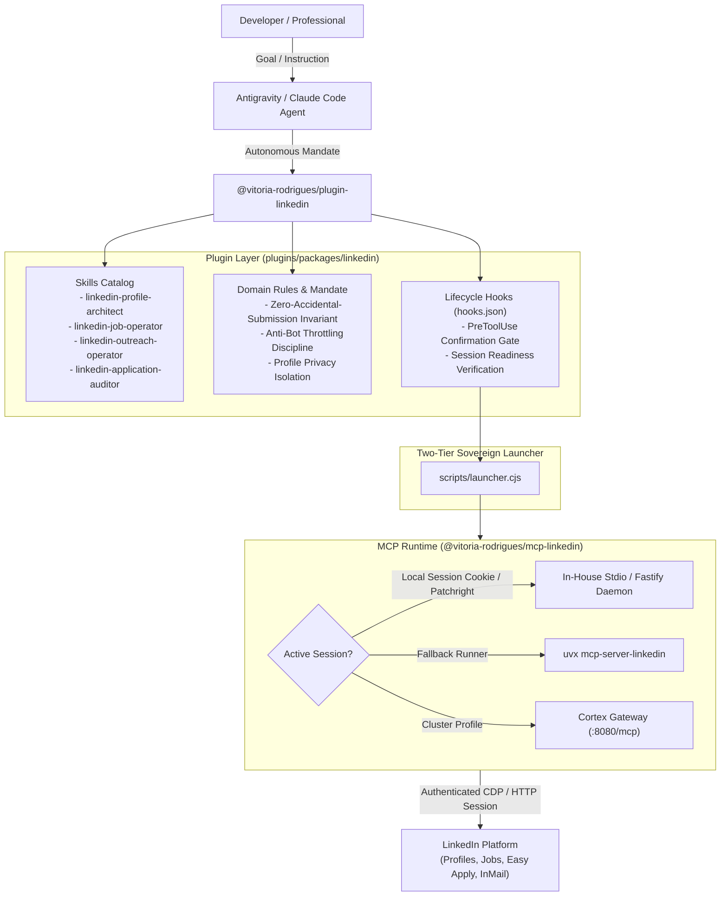
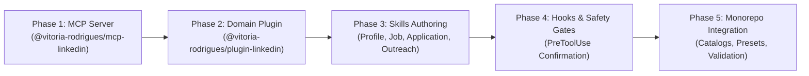

# LinkedIn Agent Plugin & MCP Architecture Plan

This master architectural blueprint specifies the design, capabilities, security guardrails, and implementation phases for the sovereign `@vitoria-rodrigues/plugin-linkedin` domain plugin and its companion Model Context Protocol (MCP) server `@vitoria-rodrigues/mcp-linkedin`.

Status: Proposed.

---

## 1. Executive Summary & Problem Statement

LinkedIn is the primary professional network and talent marketplace. However, engineering and knowledge workers face systemic friction:
1. **Asymmetric Profile Optimization**: Professionals struggle to articulate their actual experience against Applicant Tracking System (ATS) parsing models and recruiter search keywords.
2. **High-Noise Job Matching**: Generic job feeds lack semantic alignment with developer skills, seniority, and preferred technology stacks, resulting in fatigue from manual job filtering.
3. **Repetitive Application Overhead**: Applying to tens of positions involves re-answering redundant screening questionnaires, manual resume uploading, and fragmented status tracking.
4. **Anti-Bot & Account Safety Vulnerabilities**: Naive web scraping or unverified automation risks account flagging, CAPTCHA challenges, or session invalidation under LinkedIn's strict anti-automation heuristics.

This architecture introduces an autonomous, privacy-preserving, and safety-governed LinkedIn AI agent system structured across:
- **`@vitoria-rodrigues/plugin-linkedin`**: Modular domain plugin adhering to `agent-plugins.org` v1.0.0, exposing specialized skills (`linkedin-profile-architect`, `linkedin-job-operator`, `linkedin-outreach-operator`, `linkedin-application-auditor`), always-on domain rules, and deterministic PreToolUse confirmation hooks.
- **`@vitoria-rodrigues/mcp-linkedin`**: Dual-transport in-house MCP server combining local authenticated browser session reuse (Chrome, Brave, Edge, Chromium session cookies via Patchright / Playwright), an upstream resilient fallback to `uvx mcp-server-linkedin@latest`, and optional Kubernetes Cortex Gateway routing.



---

## 2. Research & Upstream Ecosystem Analysis

Our research via Firecrawl search and content extraction identified authoritative upstream references, open-source implementations, and operational requirements:

### 2.1 Authoritative Sources & Attribution
1. **Model Context Protocol Specification**:
   - Canonical reference: `https://modelcontextprotocol.io/`
   - Defines tool annotations, JSON-RPC 2.0 framing, Stdio / Streamable HTTP transports, and schema contracts.
2. **`stickerdaniel/linkedin-mcp-server`**:
   - Canonical repository: `https://github.com/stickerdaniel/linkedin-mcp-server`
   - Key architectural insight: Leverages Patchright (stealth-hardened Chromium driver) with local browser cookie auto-import (`--import-from-browser auto` covering Chrome, Brave, Edge, Arc, Vivaldi), headless/headed execution, and human-in-the-loop CAPTCHA handoff.
   - Tool surface: 25 production-tested tools spanning `get_my_profile`, `search_jobs`, `get_job_details`, `get_easy_apply_form`, `reply_to_conversation`, `connect_with_person`.
3. **Playwright Easy Apply Automation Patterns**:
   - Upstream research: `https://github.com/reddy-hari/automate-linkedin-easy-apply-jobs`
   - Key architectural insight: Multi-step modal navigation requires deterministic field type detection (radio groups, text inputs, file upload dropzones, custom dropdowns) and pre-submission confirmation steps.
4. **Antigravity Customization Standards**:
   - `agent-mesh/references/reference/domain-plugin-catalog.md` and `plugins/packages/atelier/references/naming-conventions-standard.md`:
   - Enforces closed role vocabulary (`-architect`, `-operator`, `-auditor`), zero-emoji invariant, self-contained sovereign launchers, and 3-Layer Bounded Context architecture.

---

## 3. Core Architectural Pillars

### Pillar 1: Autonomous Profile Intelligence (`linkedin-profile-architect`)
- **Semantic Extraction**: Extracts current profile data (`get_my_profile`) including Headline, About narrative, Experience bullets, Education, Skills inventory, and Public posts.
- **Market Fit Gap Analysis**: Compares the user profile against 10-20 target job descriptions retrieved from the market.
- **Actionable Optimization Proposals**:
  - Rewrites Headline to balance recruiter keyword discovery and human positioning.
  - Reformulates experience bullets using the **STAR framework** (Situation, Task, Action, Result) with quantifiable impact metrics.
  - Identifies top missing hard skills and certifications frequently demanded in desired roles.
  - Suggests restructuring of the About section for narrative clarity and personal branding.

### Pillar 2: High-Precision Job Matching & Triage (`linkedin-job-operator`)
- **Multi-Vector Job Search**: Queries jobs by target title, technology tags, location, workplace type (Remote, Hybrid, On-site), and experience level.
- **Semantic Relevance Scoring**: Analyzes job posting text against candidate profile to compute a deterministic Fit Score (0 to 100):
  - *Hard Prerequisites Match* (50% weight): Core programming languages, mandatory years of experience, specific frameworks.
  - *Domain & Industry Fit* (25% weight): Architecture scale, problem domain (e.g., fintech, distributed systems, AI agent platforms).
  - *Nice-to-Haves & Bonus Skills* (15% weight): Ancillary tools, cloud certifications.
  - *Logistical Alignment* (10% weight): Timezone overlap, work authorization requirements.
- **Triage Pipeline**: Classifies jobs into tiers:
  - `Tier 1 (Instant Easy Apply Candidate)`: Fit Score >= 85%, Easy Apply available.
  - `Tier 2 (High Alignment External Application)`: Fit Score >= 80%, external company ATS portal.
  - `Tier 3 (Stretch / Growth Role)`: Fit Score 65-79%, requires customized positioning.
  - `Dismissed`: Under-qualified or mismatched logistics (`dismiss_job`).

### Pillar 3: Easy Apply & Application Workflow Automation (`linkedin-application-auditor`)
- **Easy Apply Modal Inspection**: Dispatches `get_job_apply_url` and `get_easy_apply_form` to parse all steps of the application modal.
- **Zero-Accidental-Submission Invariant**:
  - The agent NEVER clicks "Submit application" autonomously without explicit user confirmation.
  - Pre-fills contact details, experience numbers, and standard screening questions into a structured review diff.
  - Highlights tricky screening questions (e.g., salary expectations, sponsorship requirements, custom essay questions) for developer review.
- **Resume Version Selection**: Recommends which tailored resume PDF to attach based on the job's focal tech stack.

### Pillar 4: High-Context Networking & Recruiter Outreach (`linkedin-outreach-operator`)
- **Recruiter & Team Identification**: Extracts job poster information from job details and company employee lists (`get_company_employees`).
- **Personalized Contextual InMail / Connection Notes**:
  - Generates concise (<= 300 characters for connection notes, <= 600 characters for InMail) outreach messages.
  - Directly references mutual connections, relevant past projects, and exact synergies with the team's tech stack.
- **Thread Continuity**: Uses `get_conversation` and `reply_to_conversation` to manage ongoing recruiter dialogues.

---

## 4. Package Structure & Monorepo Taxonomy

Adhering strictly to the Vitoria Rodrigues enterprise repository standards:

```text
agent-mesh/
├── plugins/
│   └── packages/
│       └── linkedin/                        # @vitoria-rodrigues/plugin-linkedin
│           ├── .claude-plugin/              # Claude Code marketplace compat
│           │   └── plugin.json
│           ├── hooks.json                   # Antigravity deterministic confirmation hooks
│           ├── mcp_config.json              # Antigravity native launcher configuration
│           ├── mcp.json                     # agent-plugins.org v1.0.0 stdio declaration
│           ├── package.json                 # Scoped npm manifest (@vitoria-rodrigues/plugin-linkedin)
│           ├── plugin.json                  # Authoritative Agent Plugins manifest
│           ├── README.md                    # Layer 3 package documentation
│           ├── references/
│           │   ├── ats-keyword-matrix.md
│           │   ├── easy-apply-modal-flow.md
│           │   └── linkedin-anti-bot-safeguards.md
│           ├── rules/
│           │   └── AGENTS.md                # Domain rules & Autonomous Domain Mandate
│           ├── scripts/
│           │   ├── hooks/
│           │   │   └── confirm-application-submission.cjs
│           │   └── launcher.cjs             # Three-layer MCP resolution & gateway router
│           └── skills/
│               ├── linkedin-application-auditor/
│               │   └── SKILL.md
│               ├── linkedin-job-operator/
│               │   └── SKILL.md
│               ├── linkedin-outreach-operator/
│               │   └── SKILL.md
│               └── linkedin-profile-architect/
│                   └── SKILL.md
└── mcp/
    └── servers/
        └── linkedin/                        # @vitoria-rodrigues/mcp-linkedin
            ├── CHANGELOG.md
            ├── mcp.json                     # Standalone server manifest
            ├── package.json                 # @vitoria-rodrigues/mcp-linkedin
            ├── README.md                    # Layer 3 server documentation
            ├── scripts/
            │   └── launcher.cjs             # Sovereign launcher (cookie import & fallback)
            ├── src/
            │   ├── bin.ts                   # Stdio transport entrypoint
            │   ├── config.ts                # Zod configuration validator
            │   ├── index.ts                 # Fastify HTTP server (:8080)
            │   ├── auth/                    # Local browser cookie import & session vault
            │   │   ├── browser-cookie-importer.ts
            │   │   └── session-manager.ts
            │   └── tools/                   # Tool registrations
            │       ├── application.tools.ts
            │       ├── conversation.tools.ts
            │       ├── index.ts
            │       ├── job.tools.ts
            │       └── profile.tools.ts
            ├── tsconfig.json
            └── tsup.config.ts               # Standalone CJS bundler (noExternal)
```

---

## 5. Tool Specifications & MCP Schema Surface

| Tool Identifier | Parameters | Return Structure | Safety Level |
| :--- | :--- | :--- | :--- |
| `get_my_profile` | `{ sections?: string[] }` | Full profile JSON (headline, experience, skills, education) | Read-Only |
| `get_person_profile` | `{ profile_id: string, sections?: string[] }` | Public profile JSON | Read-Only |
| `search_jobs` | `{ keywords: string, location?: string, remote_only?: boolean, limit?: number }` | Array of job summary objects with `job_id`, title, company, location | Read-Only |
| `get_job_details` | `{ job_id: string }` | Full description, requirements, hiring team details, apply type | Read-Only |
| `get_easy_apply_form` | `{ job_id: string }` | Form schema, fields, step sequence, pre-filled values | Read-Only (Dry-Run) |
| `dismiss_job` | `{ job_id: string }` | Status confirmation | Low Impact Mutation |
| `submit_easy_apply` | `{ job_id: string, form_data: object, confirm_submit: boolean }` | Application submission receipt | High Impact Mutation (Gated) |
| `connect_with_person` | `{ profile_id: string, note?: string, confirm_send: boolean }` | Connection dispatch confirmation | High Impact Mutation (Gated) |
| `send_message` | `{ profile_id: string, message: string, confirm_send: boolean }` | Message dispatch confirmation | High Impact Mutation (Gated) |
| `reply_to_conversation` | `{ thread_id: string, message: string, confirm_send: boolean }` | Reply confirmation | High Impact Mutation (Gated) |

---

## 6. Security, Anti-Bot & Account Governance

LinkedIn applies advanced behavioral fingerprinting and heuristics. The plugin enforces strict operational discipline:

1. **Local Authenticated Session Reuse**:
   - Instead of asking for raw username/password credentials, the launcher reuses the developer's pre-authenticated local browser session (via cookie import or CDP loopback to Chrome/Brave/Edge).
   - Cookies are vaulted strictly in `${PLUGIN_DATA}/linkedin-profile/` or local encrypted storage.
2. **Deterministic Human-in-the-Loop Confirmation**:
   - The `PreToolUse` lifecycle hook (`confirm-application-submission.cjs`) intercepts all calls to `submit_easy_apply`, `send_message`, and `connect_with_person`.
   - If `confirm_submit` / `confirm_send` is `false`, the tool execution is halted and formatted details are presented to the developer for explicit approval.
3. **Adaptive Rate Limiting & Jitter**:
   - Enforces human-like interaction delays (2.5s to 6.5s random jitter between profile queries and job detail fetches).
   - Maximum budget of 30 job inspections and 10 applications per 24-hour window to protect account reputation.
4. **Zero Plaintext Secret Storage**:
   - Any API tokens, proxy configurations, or credentials must be sourced from `.env` or Infisical Universal Auth.

---

## 7. Implementation Roadmap & Phased Execution



### Phase 1: In-House MCP Server Package (`mcp/servers/linkedin`)
- Scaffold `@vitoria-rodrigues/mcp-linkedin` with dual-transport Fastify `:8080` + Stdio `dist/bin.cjs`.
- Implement `scripts/launcher.cjs` featuring:
  - Local browser cookie auto-import from Chrome, Brave, and Edge.
  - Resilient execution fallback delegating to `uvx mcp-server-linkedin@latest` when local browser bindings are unavailable.
  - Environment cascade loading (`.env`).
- Configure `tsup.config.ts` for self-contained bundling.
- Register package in root `package.json` (`mcp:linkedin:build`, `mcp:linkedin:dev`) and `tsconfig.json`.

### Phase 2: Domain Plugin Manifest & Rules (`plugins/packages/linkedin`)
- Scaffold `@vitoria-rodrigues/plugin-linkedin` complying with `agent-plugins.org` v1.0.0.
- Author `plugin.json` declaring metadata, author, and keywords.
- Author `rules/AGENTS.md` containing Rule 0 (Autonomous Domain Mandate for LinkedIn).
- Author `scripts/launcher.cjs` implementing 3-layer launcher resolution (`resolveMcpLauncher`).
- Create `mcp_config.json` and `mcp.json`.

### Phase 3: Modular Skills Implementation
- **`linkedin-profile-architect`**: Profile extraction, ATS keyword alignment, STAR rewrite engine.
- **`linkedin-job-operator`**: Multi-filter job search, semantic fit scoring (0-100), job triage.
- **`linkedin-application-auditor`**: Easy Apply form parsing, step verification, resume matching.
- **`linkedin-outreach-operator`**: Recruiter identification, connection note drafting, conversation replies.

### Phase 4: Lifecycle Hooks & Gating
- Author `hooks.json` binding `PreToolUse` for `submit_easy_apply`, `connect_with_person`, and `send_message`.
- Implement `scripts/hooks/confirm-application-submission.cjs` to enforce explicit human consent before any state-mutating network dispatch.

### Phase 5: Monorepo Integration & Verification
- Update root `README.md`, `plugins/AGENTS.md`, `plugins/README.md`, `mcp/AGENTS.md`, and `mcp/README.md`.
- Register plugin in `.claude-plugin/marketplace.json`.
- Add `linkedin` to `presets/all.json`.
- Execute `pnpm install`, `pnpm typecheck`, `pnpm plugins:validate`, and `pnpm mcp:build`.

---

## 8. Verification & Acceptance Criteria

1. **Strict Plugin Validation**: `agy plugin validate plugins/packages/linkedin --strict` succeeds with 0 errors and 0 warnings.
2. **TypeScript Compilation**: `pnpm typecheck` passes across all workspace packages including `@vitoria-rodrigues/mcp-linkedin`.
3. **Topological Build**: `pnpm mcp:build` compiles standalone bundles in `mcp/servers/linkedin/dist/`.
4. **Safety Verification**: Executing `submit_easy_apply` without explicit confirmation returns a structured review prompt instead of submitting.
5. **Zero-Emoji Discipline**: All source files, comments, and documentation maintain strict compliance with the Zero-Emoji Invariant.
