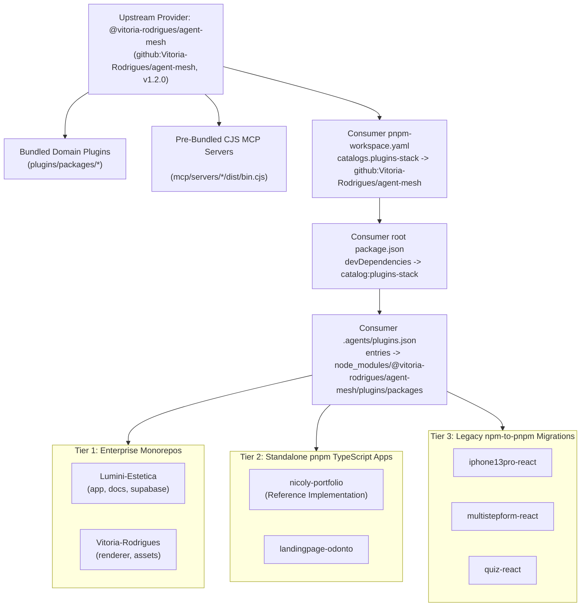
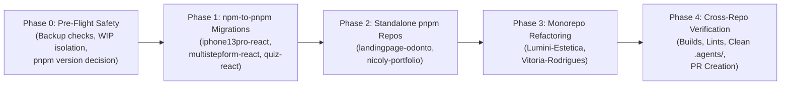

# Organization-Wide Repository Standardization & Agent Mesh Rollout Plan

This master architectural blueprint establishes the cross-repository standardization plan for all repositories under `Vitoria-Rodrigues`, unifying AI agent governance (`AGENTS.md`), developer documentation (`README.md`), cleanroom `.agents/` workspace configurations (`plugins.json`), and standardized Node.js package management (`pnpm` with named catalogs) powered by `@vitoria-rodrigues/agent-mesh`.

Status: Proposed.

---

## 1. Executive Summary & Strategic Objectives

A deep read-only audit of all eight repositories located in the parent workspace directory (`../`) revealed significant structural divergence across package managers, dependency scoping, documentation quality, `AGENTS.md` context routers, and legacy `.agents/` directories. While `nicoly-portfolio` pioneered the target `@vitoria-rodrigues/agent-mesh` consumption pattern via `.agents/plugins.json`, other repositories either rely on legacy npm lockfiles (`package-lock.json`), lack `AGENTS.md` and `.agents/` entirely, or carry hundreds of obsolete `.agents/` files (`agentgateway` documentation mirrors, deprecated `cortex` plugins, and legacy `*-expert` skills) alongside severe metadata and identity drift.

This plan coordinates five core standardization pillars across all seven consumer repositories (`Lumini-Estetica`, `Vitoria-Rodrigues`, `nicoly-portfolio`, `landingpage-odonto`, `iphone13pro-react`, `multistepform-react`, and `quiz-react`), treating `agent-mesh` as the upstream provider hub:

1. **Universal `AGENTS.md` Context Routers**: Establish compliant Layer 1 root `AGENTS.md` routers in every repository and refactor existing Layer 2 workspace routers to use canonical `<context-hierarchy>` XML inheritance and `@vitoria-rodrigues/agent-mesh` skill references (`router-architect`, `readme-architect`, `monorepo-architect`, `github-flow-operator`, `docusaurus-*`, `web`).
2. **Enterprise `README.md` Modernization**: Upgrade every repository `README.md` to en-US GitHub Flavored Markdown (GFM) standards with Mermaid architecture diagrams, accurate ASCII directory trees, aligned script tables, pnpm setup instructions, Zero-Emoji compliance, and full AGENTS-README co-existence.
3. **`.agents/` Cleanroom Remediation**: Wipe all obsolete `.agents/` content across legacy repositories (`quiz-react`, `Vitoria-Rodrigues`, `Lumini-Estetica`) and scaffold clean `.agents/` directories in repositories that lack them (`iphone13pro-react`, `landingpage-odonto`, `multistepform-react`).
4. **Canonical `.agents/plugins.json` Registration**: Standardize every consumer `.agents/` folder to contain exclusively `.agents/plugins.json` importing plugins from `node_modules/@vitoria-rodrigues/agent-mesh/plugins/packages`.
5. **pnpm & Named Catalogs Standardization**: Migrate all legacy npm repositories (`package-lock.json`) to pnpm (`pnpm-lock.yaml`), introduce `pnpm-workspace.yaml` with named catalogs (`catalog:`, `catalogs.plugins-stack`, `catalogs.web-stack`, `catalogs.tooling-stack`) across every Node.js repository, eliminate raw dependency versions, standardize `@vitoria-rodrigues/` package scoping, and install `@vitoria-rodrigues/agent-mesh` via the zero-token Git channel (`github:Vitoria-Rodrigues/agent-mesh`).

> [!IMPORTANT]
> **Critical Filename Specification (`.agents/plugins.json` vs. `plugin.json`)**:
> While informally referred to as `plugin.json` in casual requests, the authoritative Antigravity workspace plugin registry filename is **`.agents/plugins.json`** (plural). This is verified by `nicoly-portfolio/.agents/plugins.json`, `agent-mesh/.agents/plugins.json`, and the Antigravity JSON Configuration Guide (`plugins.json` at the customization root). The singular `plugin.json` filename is reserved strictly for individual plugin package manifests (such as `plugins/packages/atelier/plugin.json`). All consumer repositories MUST create `.agents/plugins.json` to ensure native Antigravity plugin discovery.



---

## 2. Portfolio-Wide Deep Audit Matrix

### 2.1 Local Toolchain & Signing Baseline

Verified on the workstation during audit execution:
- **Node.js**: `v24.16.0`
- **pnpm**: `10.33.2`
- **Git**: `2.54.0.windows.1`
- **SSH Signing Key (`git config user.signingkey`)**: Unconfigured (empty) across all eight repositories. Per enterprise governance rule 1, standard Conventional Commits (`git commit -m "..."`) are permitted in environments without configured signing keys; if SSH signing is later provisioned, all commits and annotated tags MUST switch to `git commit -S -m "..."`.

### 2.2 Cross-Repository Inventory & Gap Analysis

| Repository | Role / Stack | Branch & Git State | Current Package Manager & Lockfile | Current Package Name(s) | Current `.agents/` State | Root & Workspace `AGENTS.md` | `README.md` & Docs State | Critical Findings & Gaps |
| :--- | :--- | :--- | :--- | :--- | :--- | :--- | :--- | :--- |
| `agent-mesh` | Upstream provider monorepo (pnpm + Turborepo + TS) | `main` (Clean) | `pnpm@10.33.2`, `pnpm-lock.yaml`, `pnpm-workspace.yaml` (named catalogs) | `@vitoria-rodrigues/agent-mesh`, `@vitoria-rodrigues/plugin-*`, `@vitoria-rodrigues/mcp-*` | Planning hub + `.agents/plugins.json` -> `plugins/packages` | Layer 1 + Layer 2 + Layer 3 compliant | Compliant | Exempt from consumer wipe. Self-audit note: `.agents/AGENTS.md` and `.agents/README.md` contain links to removed `analyses/`, `reports/`, and older `plans/` files. |
| `nicoly-portfolio` | Reference consumer (React 19.3, TS 6.0, R3F/Three.js, React Router 8, Vite 8.3) | `ci/setup-vercel-pipeline` (**Dirty**: modified `package.json`, `pnpm-lock.yaml`, `src/*`, untracked `src/components/*`) | `pnpm` (`pnpm-lock.yaml`), no `pnpm-workspace.yaml`, no `packageManager` field | `nicoly-portfolio` (unscoped), already includes `@vitoria-rodrigues/agent-mesh` | Canonical `.agents/plugins.json` only | **Missing** | Stock Vite template (`# React + TypeScript + Vite`) | Reference `.agents/plugins.json` exists, but missing `AGENTS.md`, `pnpm-workspace.yaml` catalogs, `@vitoria-rodrigues/` scope, real `README.md`, and CI `.github/workflows/vercel-deploy.yml` pins `pnpm` version `9`. |
| `landingpage-odonto` | Standalone app (React 19.3, TS 6.0, Vite 8.3, CSS Modules) | `main` (Clean) | `pnpm` (`pnpm-lock.yaml`), no `pnpm-workspace.yaml`, no `packageManager` field | `landingpage-odonto` (unscoped) | **Missing** | **Missing** | Strong en-US `README.md` with Mermaid architecture diagram | Missing `.agents/plugins.json`, `AGENTS.md`, `pnpm-workspace.yaml` catalogs, `@vitoria-rodrigues/` scope, and `@vitoria-rodrigues/agent-mesh` dependency. |
| `iphone13pro-react` | Standalone app (React 19.1, Vite 7.1, JS/JSX) | `main` (Clean) | **npm** (`package-lock.json`), no `pnpm-workspace.yaml` | `iphone13page` (unscoped) | **Missing** | **Missing** | Legacy pt-BR `README.md` with folder emoji in heading, `[url-do-repositorio]` placeholder, wrong `cd` casing, `npm` commands | Uses npm instead of pnpm, unscoped name, missing `.agents/plugins.json` and `AGENTS.md`, non-compliant pt-BR `README.md` with folder emoji and placeholder URL. |
| `multistepform-react` | Standalone app (React 19.1, Vite 7.1, JS/JSX) | `main` (Clean) | **npm** (`package-lock.json`), no `pnpm-workspace.yaml` | `multistep` (unscoped) | **Missing** | **Missing** | en-US `README.md` with Mermaid diagram referencing `npm` | Uses npm instead of pnpm, unscoped name, missing `.agents/plugins.json`, `AGENTS.md`, `pnpm-workspace.yaml` catalogs, and pnpm/governance docs in `README.md`. |
| `quiz-react` | Standalone app (React 19.1, Vite 7.1, JS/JSX) | `main` (Clean) | **npm** (`package-lock.json`), no `pnpm-workspace.yaml` | `quiz` (unscoped) | **Legacy bloated** (~330+ files: `agentgateway`, `cortex`, `k8s-expert`, `enterprise-architecture`, `skills/*`) | **Missing** root `AGENTS.md` (has `.agents/AGENTS.md` + plugin rules) | en-US `README.md` with Mermaid state machine referencing `npm` | Uses npm instead of pnpm, unscoped name, ~330 obsolete `.agents/` files, missing root `AGENTS.md` and `pnpm-workspace.yaml` catalogs. |
| `Lumini-Estetica` | Monorepo (React 19.3, TS 6.0, Docusaurus 3.10, Supabase, Turborepo) | `main` (**Dirty**: untracked `.agents/plans/analise-carreira-frontend.md`) | `pnpm@12.6.0` (`devEngines` + `packageManager`), `catalogMode: 'strict'`, `pnpm-workspace.yaml` | `@vitoria-rodrigues/lumini-estetica` (root), `@lumini-estetica/{app,docs,supabase}` | **Legacy bloated** (~45+ files: `AGENTS.md`, `README.md`, `mcp_config.json`, `plans/`, 5 legacy `*-expert` skills) | Root + 3 workspaces (`app`, `docs`, `supabase`) using legacy `<context-hierarchy src="...">` and legacy skills | Root + 3 workspace `README.md` files with stale/placeholder text | Untracked plan inside `.agents/plans/`, legacy `.agents/` skills, broken `AUDITORIA.md` links in `docs/AGENTS.md` and `supabase/README.md`, `app/README.md` has placeholder text, `docs/README.md` uses `npm run`, `app/.env` lacks `app/.env.example`, `pnpm@12.6.0` vs local `10.33.2` drift. |
| `Vitoria-Rodrigues` | GitHub profile monorepo (SVG renderer + design tokens, Turborepo) | `main` (Clean) | `pnpm@12.6.0` (`packageManager`), `catalogMode: 'strict'`, `pnpm-workspace.yaml` | `@vitoriarodrigues/profile` (missing hyphen), `@profile/{renderer,assets}` | **Legacy bloated** (~350+ files: `agentgateway`, `cortex`, `github-organization`, `k8s-expert`, `secrets-expert`, `skills/*`) | Root + `renderer/AGENTS.md` (`assets/AGENTS.md` missing); root has `tupynambalucas.dev` contamination | Root `README.md` is **compiled** from `readme.template.md`; `assets/README.md` & `renderer/README.md` contaminated | **P0 identity contamination** (`tupynambalucas.dev`, `Tupynamba Lucas`, `@tupynambalucas/assets`), ~350 obsolete `.agents/` files, duplicate `dotenv` key in `catalog:` and `shared-stack`, unused catalog bloat, missing `assets/AGENTS.md`, root scope typo `@vitoriarodrigues/profile`. |

---

## 3. Canonical Target Standards

Every consumer repository MUST conform strictly to the four canonical specifications below.

### 3.1 `.agents/` Cleanroom & Plugin Registry Standard

All legacy `.agents/` directories (`plans/`, `plugins/`, `references/`, `scripts/`, `skills/`, `AGENTS.md`, `README.md`, `hooks.json`, `mcp_config.json`, `.gitignore`) in consumer repositories MUST be deleted completely. Each consumer repository's `.agents/` directory MUST contain **only** one file: `.agents/plugins.json`.

**Canonical `.agents/plugins.json` (Bulk Import — Exact Match to `nicoly-portfolio`):**

```json
{
  "entries": [
    {
      "path": "node_modules/@vitoria-rodrigues/agent-mesh/plugins/packages"
    }
  ]
}
```

> [!NOTE]
> **Optional Selective Filtering (`include_only`)**:
> Antigravity supports restricting loaded plugins via `include_only` (as documented in `agent-mesh/presets/frontend-web.json` and `agent-mesh/presets/docs-portal.json`). However, to match the `nicoly-portfolio` reference implementation requested across all repositories, this plan standardizes on bulk discovery (`entries` without `include_only`), making all `agent-mesh` plugins (`atelier`, `docusaurus`, `github-flow`, `linkedin`, `repo`, `research`, `web`) immediately available from a single dependency. Repositories needing tighter token budgets in the future can add `"include_only"` without changing `package.json` or `pnpm-workspace.yaml`.

### 3.2 pnpm & Named Catalogs Standard (`pnpm-workspace.yaml` and `package.json`)

Every Node.js repository (both monorepos and single-package applications) MUST adopt **pnpm** with `pnpm-workspace.yaml` catalogs so zero raw semver strings appear in `dependencies` or `devDependencies` inside `package.json`.

#### Package Manager Version Policy

- Local workstation toolchain is `pnpm@10.33.2` (matching `agent-mesh/package.json`).
- `Lumini-Estetica` and `Vitoria-Rodrigues` currently declare `"packageManager": "pnpm@12.6.0"` (and `Lumini-Estetica` sets `"devEngines": { "packageManager": { "name": "pnpm", "version": "12.6.0" } }`), while `nicoly-portfolio/.github/workflows/vercel-deploy.yml` pins `pnpm/action-setup@v4` with `version: 9`.
- **Standardization Target**: Align all standalone repositories (`nicoly-portfolio`, `landingpage-odonto`, `iphone13pro-react`, `multistepform-react`, `quiz-react`) on `"packageManager": "pnpm@10.33.2"`, matching `agent-mesh` and the local pnpm CLI. For `Lumini-Estetica` and `Vitoria-Rodrigues`, verify CI runner compatibility (`setup-pnpm-env` composite action) and align `packageManager` to `pnpm@10.33.2` (or ensure Corepack/CI uses the declared version uniformly).

#### Consumption Channel for `@vitoria-rodrigues/agent-mesh`

Because GitHub Packages (`npm.pkg.github.com`) returns `401 Unauthorized` without a `NODE_AUTH_TOKEN` (`read:packages`) even for public packages, and `agent-mesh` commits self-contained `tsup` CommonJS MCP bundles (`!mcp/servers/*/dist/`), all consumer repositories MUST install `@vitoria-rodrigues/agent-mesh` using the zero-token Git specifier inside `pnpm-workspace.yaml`:

```yaml
catalogMode: strict
shellEmulator: true

packages:
  - '.'

catalog:
  '@types/node': ^24.19.2
  typescript: ~6.0.3

catalogs:
  plugins-stack:
    '@vitoria-rodrigues/agent-mesh': 'github:Vitoria-Rodrigues/agent-mesh'
  web-stack:
    react: ^19.3.1
    react-dom: ^19.3.1
    vite: ^8.3.6
  tooling-stack:
    eslint: ^10.14.0
```

In `package.json`:

```json
{
  "devDependencies": {
    "@vitoria-rodrigues/agent-mesh": "catalog:plugins-stack"
  }
}
```

#### Enterprise `@vitoria-rodrigues/` Scoping Rules

Per `monorepo-architect` and `repo/rules/AGENTS.md` Rule 6:
- Standalone repositories: `@vitoria-rodrigues/<repo-name>` (for example: `@vitoria-rodrigues/nicoly-portfolio`, `@vitoria-rodrigues/landingpage-odonto`, `@vitoria-rodrigues/iphone13pro-react`, `@vitoria-rodrigues/multistepform-react`, `@vitoria-rodrigues/quiz-react`).
- Monorepo roots: `@vitoria-rodrigues/lumini-estetica` (already compliant), `@vitoria-rodrigues/profile` (currently misspelled `@vitoriarodrigues/profile` without hyphen).
- **Internal Workspace Packages Caution**: `Lumini-Estetica` (`@lumini-estetica/app`, `@lumini-estetica/docs`, `@lumini-estetica/supabase`) and `Vitoria-Rodrigues` (`@profile/renderer`, `@profile/assets`) use internal workspace scopes referenced across `package.json` scripts, `turbo` filters, `.github/workflows/*.yml` (`filter: '@profile/renderer...'`), and TypeScript imports (`@profile/assets/*`). Renaming internal workspace packages to `@vitoria-rodrigues/<domain>-<subpkg>` is separated as a controlled Phase 2 decision to avoid breaking CI pipelines and import graphs unintentionally.

#### Lockfile Migration Procedure (npm to pnpm)

1. Delete `package-lock.json`.
2. Create `pnpm-workspace.yaml` with `packages: ['.']`, `catalogMode: strict`, `catalog:`, and `catalogs:`.
3. Update `package.json` (`name`, `packageManager`, `catalog:` references, and `"@vitoria-rodrigues/agent-mesh": "catalog:plugins-stack"`).
4. Execute `pnpm install` to generate `pnpm-lock.yaml` and link `node_modules/@vitoria-rodrigues/agent-mesh`.
5. Validate with `pnpm build` and `pnpm lint` (plus `tsc -b` where TypeScript is configured).

### 3.3 Hierarchical `AGENTS.md` Context Router Standard (`router-architect`)

- **3-Layer Ceiling**: Layer 1 (`/AGENTS.md`), Layer 2 (`/<workspace>/AGENTS.md`), Layer 3 (deep package if applicable). Never create `AGENTS.md` inside `.agents/`, `src/`, `components/`, or `docs/docs/`.
- **Layer 1 Required Structure**:
  1. H1 Title (`# <Project Name> Agents Context`) and concise role summary.
  2. `## Navigation`: Relative links to `./README.md`, `./.agents/plugins.json`, and any Layer 2 workspace `AGENTS.md` files.
  3. `## Architecture`: Exact verified tech stack, directory layout, state/data flow, build/lint commands, and deployment target.
  4. `## Scoped Guardrails`: en-US technical docs/code/commits, pt-BR conversational replies, Zero-Emoji Invariant, Conventional Commits v1.0.0, SSH commit signing when configured, relative markdown links only, pnpm catalog exclusivity (`catalogMode: strict`).
  5. `## Required Skills`: Canonical `@vitoria-rodrigues/agent-mesh` skill identifiers ONLY (`router-architect`, `readme-architect`, `monorepo-architect`, `github-flow-operator`, plus `docusaurus-*` or `web`/`browser-*` where relevant). Legacy names (`agent-router-expert`, `markdown-expert`, `docusaurus-expert`, `audit-expert`, `skill-expert`) are strictly forbidden.
- **Layer 2 `<context-hierarchy>` Header (Mandatory Exact Syntax)**:

```markdown
<context-hierarchy>
  <parent src="../AGENTS.md" type="global-rules" />
  <system-instruction>
    AGENT: You are operating in the <workspace-name> bounded context. If you have not read "../AGENTS.md" in this session, stop now and read it using your file-reading tools before proceeding.
  </system-instruction>
</context-hierarchy>
```

### 3.4 Enterprise `README.md` Standard (`readme-architect`)

- **AGENTS-README Co-existence Invariant**: Every directory with `AGENTS.md` MUST also contain `README.md`.
- **Mandatory Sections (Layer 1)**:
  1. H1 Title + concise project overview.
  2. `## 1. Technology Stack` or `## 1. Architecture Overview` (with Mermaid `flowchart` diagram and accurate ASCII folder tree).
  3. `## 2. Getting Started` (Node.js + pnpm prerequisites, `pnpm install`, `pnpm dev`, `pnpm build`, `pnpm preview`).
  4. `## 3. Pipeline & Key Scripts` (GFM-aligned Markdown table).
  5. `## 4. AI Agent Mesh Integration` (documenting `@vitoria-rodrigues/agent-mesh` via `catalog:plugins-stack` and `.agents/plugins.json`).
  6. `## 5. Governance Standards` (Conventional Commits, SSH signing when configured, Zero-Emoji Invariant, en-US technical documentation).
- **Special Generated-README Rule (`Vitoria-Rodrigues`)**: Because `Vitoria-Rodrigues/README.md` is compiled automatically by `@profile/renderer`, root README enhancements MUST be authored inside `renderer/src/pipelines/readme/readme.template.md` and compiled via `pnpm generate` rather than editing `README.md` directly.

---

## 4. Repository-by-Repository Remediation Blueprints

### 4.1 `nicoly-portfolio` (Reference Implementation — Complete Remaining Standardization)

**Current State**: Branch `ci/setup-vercel-pipeline` with uncommitted UI refactoring (`package.json`, `pnpm-lock.yaml`, `src/App.tsx`, `src/index.css`, `src/main.tsx`, deleted starter SVGs/PNG, untracked `src/assets/mapaTeste.webp` and `src/components/*`). Already has canonical `.agents/plugins.json` and `"@vitoria-rodrigues/agent-mesh": "github:vitoria-rodrigues/agent-mesh"` in `package.json`, plus `.github/workflows/vercel-deploy.yml`.

**Exact Remediation Steps**:
1. **Pre-Flight Git Isolation**: Commit or stash existing UI changes on `ci/setup-vercel-pipeline` before applying standardization edits so infrastructure diffs remain clean and reviewable.
2. **Preserve `.agents/plugins.json`**: Keep existing `.agents/plugins.json` as the canonical reference.
3. **Create `pnpm-workspace.yaml`**:
   - Set `catalogMode: strict`, `shellEmulator: true`, `packages: ['.']`.
   - `catalog:`: `@types/node: ^24.19.2`, `typescript: ~6.0.3`.
   - `catalogs.plugins-stack`: `'@vitoria-rodrigues/agent-mesh': 'github:Vitoria-Rodrigues/agent-mesh'` (normalizing org casing to `Vitoria-Rodrigues`).
   - `catalogs.web-stack`: `react` (`^19.3.1`), `react-dom` (`^19.3.1`), `react-router` (`^8.5.1`), `three` (`^0.187.0`), `@react-three/fiber` (`^9.8.2`), `@react-three/drei` (`^10.7.9`), `react-icons` (`^5.7.0`), `@types/react` (`^19.3.0`), `@types/react-dom` (`^19.3.0`), `@types/three` (`^0.187.0`), `@vitejs/plugin-react` (`^6.1.2`), `vite` (`^8.3.6`).
   - `catalogs.tooling-stack`: `@eslint/js` (`^10.0.1`), `eslint` (`^10.14.0`), `eslint-plugin-react-hooks` (`^7.1.1`), `eslint-plugin-react-refresh` (`^0.5.7`), `globals` (`^17.13.0`), `typescript-eslint` (`^8.72.1`).
4. **Refactor `package.json`**:
   - Rename `"name": "nicoly-portfolio"` -> `"@vitoria-rodrigues/nicoly-portfolio"`.
   - Add `"packageManager": "pnpm@10.33.2"`.
   - Replace all raw dependency versions with `catalog:`, `catalog:plugins-stack`, `catalog:web-stack`, and `catalog:tooling-stack`.
5. **Update `.github/workflows/vercel-deploy.yml`**:
   - Remove hardcoded `version: 9` from `pnpm/action-setup@v4` so CI reads `"packageManager": "pnpm@10.33.2"` from `package.json` (pnpm 9 cannot parse pnpm 10 catalog features uniformly).
   - Update `node-version: 22` (or `24`) and standardize job/step labels to en-US to satisfy the Technical Language Policy.
6. **Create Layer 1 `AGENTS.md`**:
   - Document React 19 + TypeScript 6 + React Three Fiber (`three`, `@react-three/fiber`, `@react-three/drei`) + React Router 8 + Vite 8 + Vercel deployment architecture.
   - Document verified layout (`src/components/layout/NavBar/`, `src/components/ui/{Button,Card,MapModal,ThemeToggle}/`, `src/assets/`).
   - Reference skills: `router-architect`, `readme-architect`, `monorepo-architect`, `github-flow-operator`, `browser-auditor`.
7. **Replace Boilerplate `README.md`**:
   - Replace the stock Vite template with full project documentation (overview, tech stack, Mermaid component/layout diagram, ASCII folder tree, pnpm getting started, scripts table including `pnpm lint` and `pnpm build`, Vercel CI/CD workflow summary, `.agents/plugins.json` integration, and governance standards).
8. **Install & Verify**: Run `pnpm install`, `pnpm lint`, and `pnpm build`.

---

### 4.2 `landingpage-odonto`

**Current State**: Clean `main` branch. Uses pnpm (`pnpm-lock.yaml`) with React 19.3.1, TypeScript 6.0.3, Vite 8.3.4, CSS Modules, and fluid `clamp()` responsive styling for Joyce Martins Odontologia. Missing `.agents/`, `AGENTS.md`, `pnpm-workspace.yaml`, `@vitoria-rodrigues/` scope, and `@vitoria-rodrigues/agent-mesh`. Already has a strong en-US `README.md`.

**Exact Remediation Steps**:
1. **Create `.agents/plugins.json`** with the canonical `entries` block.
2. **Create `pnpm-workspace.yaml`**:
   - `catalogMode: strict`, `packages: ['.']`.
   - `catalog:`: `@types/node: ^24.19.2`, `typescript: ^6.0.3`.
   - `catalogs.plugins-stack`: `'@vitoria-rodrigues/agent-mesh': 'github:Vitoria-Rodrigues/agent-mesh'`.
   - `catalogs.web-stack`: `react` (`^19.3.1`), `react-dom` (`^19.3.1`), `react-icons` (`^5.7.0`), `@types/react` (`^19.3.0`), `@types/react-dom` (`^19.3.0`), `@vitejs/plugin-react` (`^6.1.2`), `vite` (`^8.3.4`).
   - `catalogs.tooling-stack`: `@eslint/js` (`^10.0.1`), `eslint` (`^10.13.0`), `eslint-plugin-react-hooks` (`^7.1.1`), `eslint-plugin-react-refresh` (`^0.5.7`), `globals` (`^17.13.0`), `typescript-eslint` (`^8.71.2`).
3. **Update `package.json`**:
   - Rename `"name": "landingpage-odonto"` -> `"@vitoria-rodrigues/landingpage-odonto"`.
   - Add `"packageManager": "pnpm@10.33.2"`.
   - Convert all dependencies to catalog references and add `"@vitoria-rodrigues/agent-mesh": "catalog:plugins-stack"` in `devDependencies`.
4. **Create Layer 1 `AGENTS.md`**:
   - Document Joyce Martins Odontologia referral landing page, fluid CSS `clamp()` design rules, CSS Modules structure (`src/components/Button/`, `src/components/Card/`), strict TypeScript (`tsc -b && vite build`), and required skills (`router-architect`, `readme-architect`, `monorepo-architect`, `github-flow-operator`, `browser-auditor`).
5. **Enhance `README.md`**:
   - Update Prerequisites to specify pnpm `>=10` (matching `packageManager`).
   - Update the `Project Structure` ASCII tree to include `.agents/plugins.json`, `AGENTS.md`, and `pnpm-workspace.yaml`.
   - Add `## AI Agent Mesh Integration` and `## Governance Standards` sections.
6. **Install & Verify**: Run `pnpm install`, `pnpm lint`, and `pnpm build`.

---

### 4.3 `iphone13pro-react`

**Current State**: Clean `main` branch. Uses **npm** (`package-lock.json`), unscoped `"name": "iphone13page"`, React 19.1.1, Vite 7.1.2, ESLint 9.33.0, JS/JSX (`src/pages/Home.jsx`, `src/components/{Button,Card,Header,NaviPhone,PromoBanner}`). Missing `.agents/` and `AGENTS.md`. `README.md` is in Portuguese (pt-BR), contains a folder emoji in the `Estrutura de Pastas` heading, an unresolved placeholder (`[url-do-repositorio]`), wrong directory casing (`cd iPhone13Pro-React`), and `npm` commands.

**Exact Remediation Steps**:
1. **Migrate Lockfile**: Delete `package-lock.json`.
2. **Create `.agents/plugins.json`** with the canonical `entries` block.
3. **Create `pnpm-workspace.yaml`**:
   - `catalogMode: strict`, `packages: ['.']`.
   - `catalogs.plugins-stack`: `'@vitoria-rodrigues/agent-mesh': 'github:Vitoria-Rodrigues/agent-mesh'`.
   - `catalogs.web-stack`: `react` (`^19.1.1`), `react-dom` (`^19.1.1`), `@types/react` (`^19.1.10`), `@types/react-dom` (`^19.1.7`), `@vitejs/plugin-react` (`^5.0.0`), `vite` (`^7.1.2`).
   - `catalogs.tooling-stack`: `@eslint/js` (`^9.33.0`), `eslint` (`^9.33.0`), `eslint-plugin-react-hooks` (`^5.2.0`), `eslint-plugin-react-refresh` (`^0.4.20`), `globals` (`^16.3.0`).
4. **Update `package.json`**:
   - Rename `"name": "iphone13page"` -> `"@vitoria-rodrigues/iphone13pro-react"`.
   - Add `"packageManager": "pnpm@10.33.2"`.
   - Convert all dependencies to catalog references and add `"@vitoria-rodrigues/agent-mesh": "catalog:plugins-stack"`.
5. **Create Layer 1 `AGENTS.md`**:
   - Document React 19 + Vite 7 JSX architecture, dynamic iPhone 13 Pro color switcher flow (`Home.jsx`, `NaviPhone.jsx`, `PromoBanner.jsx`, `src/assets/img/`), Vercel hosting target (`https://iphone13-pro-react.vercel.app/`), and required skills (`router-architect`, `readme-architect`, `monorepo-architect`, `github-flow-operator`, `browser-auditor`).
6. **Rewrite `README.md` in en-US**:
   - Remove all Portuguese text and the folder emoji in the structure heading.
   - Fix repository clone URL (`https://github.com/Vitoria-Rodrigues/iphone13pro-react.git`) and directory name (`cd iphone13pro-react`).
   - Replace `npm` commands with `pnpm` (`pnpm install`, `pnpm dev`, `pnpm build`, `pnpm lint`, `pnpm preview`).
   - Add a Mermaid `flowchart TD` component hierarchy diagram, accurate ASCII directory tree (`src/assets/img/`, `src/components/`, `src/pages/`, `.agents/plugins.json`, `AGENTS.md`, `pnpm-workspace.yaml`), aligned Key Scripts table, AI Agent Mesh section, and Governance Standards section.
7. **Install & Verify**: Run `pnpm install`, `pnpm lint`, and `pnpm build`.

---

### 4.4 `multistepform-react`

**Current State**: Clean `main` branch. Uses **npm** (`package-lock.json`), unscoped `"name": "multistep"`, React 19.1.1, `react-icons` 5.5.0, Vite 7.1.2, ESLint 10.0.2, JS/JSX (`App.jsx`, `hooks/useForm.jsx`, `components/{Steps,UserForm,ReviewForm,Thanks}`). Missing `.agents/` and `AGENTS.md`. `README.md` is already en-US with a Mermaid diagram but documents `npm` and lacks governance/catalog documentation.

**Exact Remediation Steps**:
1. **Migrate Lockfile**: Delete `package-lock.json`.
2. **Create `.agents/plugins.json`** with the canonical `entries` block.
3. **Create `pnpm-workspace.yaml`**:
   - `catalogMode: strict`, `packages: ['.']`.
   - `catalogs.plugins-stack`: `'@vitoria-rodrigues/agent-mesh': 'github:Vitoria-Rodrigues/agent-mesh'`.
   - `catalogs.web-stack`: `react` (`^19.1.1`), `react-dom` (`^19.1.1`), `react-icons` (`^5.5.0`), `@types/react` (`^19.1.10`), `@types/react-dom` (`^19.1.7`), `@vitejs/plugin-react` (`^5.0.0`), `vite` (`^7.1.2`).
   - `catalogs.tooling-stack`: `@eslint/js` (`^9.33.0`), `eslint` (`^10.0.2`), `eslint-plugin-react-hooks` (`^5.2.0`), `eslint-plugin-react-refresh` (`^0.4.20`), `globals` (`^16.3.0`).
4. **Update `package.json`**:
   - Rename `"name": "multistep"` -> `"@vitoria-rodrigues/multistepform-react"`.
   - Add `"packageManager": "pnpm@10.33.2"`.
   - Convert all dependencies to catalog references and add `"@vitoria-rodrigues/agent-mesh": "catalog:plugins-stack"`.
5. **Create Layer 1 `AGENTS.md`**:
   - Document the multi-step wizard architecture, lifted state pattern in `src/App.jsx`, `src/hooks/useForm.jsx` step controller, and components (`Steps.jsx`, `UserForm.jsx`, `ReviewForm.jsx`, `Thanks.jsx`), plus required skills (`router-architect`, `readme-architect`, `monorepo-architect`, `github-flow-operator`).
6. **Enhance `README.md`**:
   - Preserve the existing Mermaid workflow diagram while updating Prerequisites, Installation, and Running Locally from `npm` to `pnpm`.
   - Convert `## Key Scripts` from a bullet list to an aligned GFM table (`Command`, `Description`).
   - Add a complete ASCII directory tree including `.agents/plugins.json`, `AGENTS.md`, and `pnpm-workspace.yaml`.
   - Add `## AI Agent Mesh Integration` and `## Governance Standards` sections.
7. **Install & Verify**: Run `pnpm install`, `pnpm lint`, and `pnpm build`.

---

### 4.5 `quiz-react`

**Current State**: Clean `main` branch. Uses **npm** (`package-lock.json`), unscoped `"name": "quiz"`, React 19.1.1, Vite 7.1.2, ESLint 9.33.0, JS/JSX (`context/quiz.jsx`, `data/{questions,questions_complete}.js`, `components/{GameOver,Option,PickCategory,Question,Welcome}`). Contains a **massive ~330-file legacy `.agents/` directory** (mirrored `agentgateway` docs, `cortex`/`k8s-expert` plugins, `enterprise-architecture` plans, `brand-identity` references, `scripts/`, and legacy `*-expert` skills) and **no** root `AGENTS.md`.

**Exact Remediation Steps**:
1. **`.agents/` Cleanroom Wipe**: Delete the entire legacy `.agents/` directory (~330+ files) after confirming via `git status` that no unique uncommitted work exists (all verified clean and unrelated to the React quiz application).
2. **Create `.agents/plugins.json`** with the canonical `entries` block.
3. **Migrate Lockfile**: Delete `package-lock.json`.
4. **Create `pnpm-workspace.yaml`**:
   - `catalogMode: strict`, `packages: ['.']`.
   - `catalogs.plugins-stack`: `'@vitoria-rodrigues/agent-mesh': 'github:Vitoria-Rodrigues/agent-mesh'`.
   - `catalogs.web-stack`: `react` (`^19.1.1`), `react-dom` (`^19.1.1`), `@types/react` (`^19.1.10`), `@types/react-dom` (`^19.1.7`), `@vitejs/plugin-react` (`^5.0.0`), `vite` (`^7.1.2`).
   - `catalogs.tooling-stack`: `@eslint/js` (`^9.33.0`), `eslint` (`^9.33.0`), `eslint-plugin-react-hooks` (`^5.2.0`), `eslint-plugin-react-refresh` (`^0.4.20`), `globals` (`^16.3.0`).
5. **Update `package.json`**:
   - Rename `"name": "quiz"` -> `"@vitoria-rodrigues/quiz-react"`.
   - Add `"packageManager": "pnpm@10.33.2"`.
   - Convert all dependencies to catalog references and add `"@vitoria-rodrigues/agent-mesh": "catalog:plugins-stack"`.
6. **Create Layer 1 `AGENTS.md`**:
   - Document React Context API (`src/context/quiz.jsx` and `quizReducer`), the 4-stage state machine (`Start`, `Category`, `Playing`, `End`), static question banks (`src/data/questions.js`, `src/data/questions_complete.js`), UI views (`Welcome`, `PickCategory`, `Question`, `Option`, `GameOver`), and required skills (`router-architect`, `readme-architect`, `monorepo-architect`, `github-flow-operator`).
7. **Enhance `README.md`**:
   - Preserve the existing Mermaid state-machine diagram while switching Prerequisites, Installation, and Key Scripts from `npm` to `pnpm` (`pnpm install`, `pnpm dev`, `pnpm build`, `pnpm lint`, `pnpm preview`).
   - Convert Key Scripts to an aligned GFM table and add a complete ASCII project tree (including `.agents/plugins.json`, `AGENTS.md`, `pnpm-workspace.yaml`).
   - Add `## AI Agent Mesh Integration` and `## Governance Standards` sections.
8. **Install & Verify**: Run `pnpm install`, `pnpm lint`, and `pnpm build`.

---

### 4.6 `Lumini-Estetica`

**Current State**: Monorepo on `main` with **dirty** working tree (`?? .agents/plans/analise-carreira-frontend.md`). Root `package.json` is `@vitoria-rodrigues/lumini-estetica` (`pnpm@12.6.0` + `devEngines`); workspaces are `@lumini-estetica/app`, `@lumini-estetica/docs`, and `@lumini-estetica/supabase` managed via `pnpm-workspace.yaml` (`catalogMode: 'strict'`) and `turbo.json`. `.agents/` contains 45+ legacy files (`AGENTS.md`, `README.md`, `mcp_config.json`, `plans/`, and 5 legacy `*-expert` skills). Root and all 3 workspaces have `AGENTS.md` and `README.md`, but contain legacy `<context-hierarchy src="../AGENTS.md">` syntax, legacy skill names, broken `AUDITORIA.md` links, placeholder scripts in `app/README.md`, `npm` commands in `docs/README.md`, and a missing `app/.env.example` alongside `app/.env`. Verified `.vscode/scripts/launch-agy.ps1` only clears host and runs `agy` (no dependency on legacy `.agents/` files).

**Exact Remediation Steps**:
1. **Pre-Flight Archival Check**: Confirm with the user whether untracked `.agents/plans/analise-carreira-frontend.md` should be backed up outside the repo before wiping `.agents/`.
2. **`.agents/` Cleanroom Wipe**: Delete all legacy `.agents/` contents (`AGENTS.md`, `README.md`, `mcp_config.json`, `plans/`, `skills/`) and leave strictly `.agents/plugins.json`.
3. **Update `pnpm-workspace.yaml` & `package.json`**:
   - Add `plugins-stack: { '@vitoria-rodrigues/agent-mesh': 'github:Vitoria-Rodrigues/agent-mesh' }` under `catalogs:` in `pnpm-workspace.yaml` (mandatory under `catalogMode: 'strict'`).
   - Add `"@vitoria-rodrigues/agent-mesh": "catalog:plugins-stack"` to root `package.json` `devDependencies`.
   - Reconcile `packageManager` and `devEngines` (`pnpm@12.6.0` vs local `pnpm@10.33.2`) consistently with `.github/actions/setup-pnpm-env`.
   - Document as an optional Phase 2 governance alignment: renaming `@lumini-estetica/{app,docs,supabase}` to `@vitoria-rodrigues/lumini-{app,docs,supabase}` (requires coordinated updates to root `package.json` filter scripts and `.github/workflows/deploy-*.yaml`).
4. **Refactor All 4 `AGENTS.md` Routers**:
   - **Root `AGENTS.md`**: Remove `[.agents/](./.agents/AGENTS.md)` link; add link to `./.agents/plugins.json`; replace legacy skills (`agent-router-expert`, `markdown-expert`) with canonical `agent-mesh` skills (`router-architect`, `readme-architect`, `monorepo-architect`, `docusaurus-architect`, `docusaurus-mdx-architect`, `docusaurus-auditor`, `github-flow-operator`); clarify language policy so all code, configs, commits, `AGENTS.md`, and `README.md` files remain strictly en-US while end-user clinical documentation inside `docs/docs/` follows its configured Docusaurus locale.
   - **`app/AGENTS.md`**: Upgrade to canonical `<context-hierarchy>` XML syntax (`<parent src="../AGENTS.md" type="global-rules" />` + `<system-instruction>`); add Navigation, Architecture (React 19, Vite 8, TanStack Query, Zod, Supabase, Stripe), and Scoped Guardrails (including `.env.example` invariant).
   - **`docs/AGENTS.md`**: Upgrade to canonical `<context-hierarchy>` XML syntax; remove broken link `[AUDITORIA.md](../AUDITORIA.md)`; replace `docusaurus-expert` and `markdown-expert` with `docusaurus-architect`, `docusaurus-mdx-architect`, and `docusaurus-auditor`.
   - **`supabase/AGENTS.md`**: Upgrade to canonical `<context-hierarchy>` XML syntax; replace `agent-router-expert` and `markdown-expert` with `router-architect` and `readme-architect`.
5. **Upgrade All 4 `README.md` Files & Add Missing `.env.example`**:
   - **Root `README.md`**: Remove `[.agents/](./.agents/)` link; link explicitly to `./app/README.md`, `./docs/README.md`, `./supabase/README.md`; add a Mermaid monorepo architecture diagram, ASCII directory tree, Getting Started (`pnpm install`), Turborepo Pipeline Scripts table (`app:dev`, `app:build`, `docs:dev`, `docs:build`, `build`, `lint`, `typecheck`), AI Agent Mesh section, and Governance Standards section.
   - **`app/README.md`**: Replace the placeholder `*(Development scripts and commands will be documented here as the project evolves.)*` with actual scripts (`dev`, `build`, `lint`, `typecheck`, `preview`), architecture details, and environment variable documentation.
   - **`app/.env.example`**: Create a scrubbed template mirroring `app/.env` keys with `<YOUR_VARIABLE_NAME>` placeholders (fulfilling Atelier Rule 7 and Repo Rule 8).
   - **`docs/README.md`**: Replace `npm run start` and `npm run build` with `pnpm --filter "@lumini-estetica/docs" start` (`pnpm docs:dev`) and `pnpm docs:build`, and document Diátaxis documentation quadrants (`tutorials/`, `how-to-guides/`, `reference/`, `explanation/`).
   - **`supabase/README.md`**: Remove the broken `AUDITORIA.md` reference and document `pnpm --filter @lumini-estetica/supabase types:generate` and Supabase CLI workflows.
6. **Install & Verify**: Run `pnpm install`, `pnpm typecheck`, `pnpm lint`, and `pnpm build`.

---

### 4.7 `Vitoria-Rodrigues`

**Current State**: Clean `main` branch. Profile monorepo with Turborepo (`@vitoriarodrigues/profile`, `@profile/renderer`, `@profile/assets`), `pnpm@12.6.0`, `catalogMode: 'strict'`. Contains ~350+ obsolete files in `.agents/` (including `agentgateway`, deprecated plugins `cortex`/`github-organization`/`k8s-expert`/`secrets-expert`, `CLOUDFLARE_AGENTS.md`, `Guia Corporativo GitHub e GitLab.md`, `plans/analise-carreira-frontend.md`, `scripts/`, `skills/`). **P0 Critical Finding**: Severe identity contamination from an external template (`tupynambalucas.dev` / `Tupynamba Lucas` / `@tupynambalucas/assets`) across root `AGENTS.md`, `assets/package.json`, `assets/README.md`, and `renderer/README.md`. Additionally, `pnpm-workspace.yaml` duplicates `dotenv` across `catalog:` and `catalogs.shared-stack` and contains dozens of unused third-party packages (`wrangler`, `miniflare`, `@sentry/*`, `bcrypt`, `sharp`, `@marsidev/react-turnstile`, `react-force-graph-2d`, `@aws-sdk/client-s3`), root `package.json` omits the hyphen in `@vitoria-rodrigues/`, `assets/` lacks `AGENTS.md`, and root `README.md` is generated by `@profile/renderer` from `renderer/src/pipelines/readme/readme.template.md`. Verified `.husky/pre-commit` executes `pnpm exec tsx scripts/pre-commit.ts` with zero dependency on `.agents/`.

**Exact Remediation Steps**:
1. **Pre-Flight Archival Check**: Confirm whether tracked `.agents/plans/analise-carreira-frontend.md` needs archival before deleting `.agents/`.
2. **`.agents/` Cleanroom Wipe**: Delete all ~350+ legacy files in `.agents/` (`AGENTS.md`, `README.md`, `hooks.json`, `.gitignore`, `plans/`, `plugins/`, `references/`, `scripts/`, `skills/`) and leave strictly `.agents/plugins.json`.
3. **Identity Contamination Remediation (P0)**:
   - **Root `AGENTS.md`**: Replace `# tupynambalucas.dev Agents Context` and all `Tupynambalucas` / `tupynambalucas.dev` references with `Vitoria-Rodrigues` (`vitoriarodrigues.dev`); remove `[.agents](./.agents/AGENTS.md)` link; add link to `./.agents/plugins.json`; replace legacy skills (`agent-router-expert`, `markdown-expert`) with canonical `agent-mesh` skills (`router-architect`, `readme-architect`, `monorepo-architect`, `github-flow-operator`).
   - **`assets/package.json`**: Replace the contaminated author, homepage, and repository URL fields (`tupynambalucas`) with `Vitória Rodrigues Ferreira <vitoriarodrigues.dev>`, `https://vitoriarodrigues.dev`, and `git+https://github.com/Vitoria-Rodrigues/Vitoria-Rodrigues.git`.
   - **`assets/README.md`**: Replace all `@tupynambalucas/assets` references with `@profile/assets` (or `@vitoria-rodrigues/profile-assets` if workspace packages are renamed) and verify link targets exist.
   - **`renderer/README.md`**: Replace `tupynambalucas/tupynambalucas` example on line 36 with `Vitoria-Rodrigues/Vitoria-Rodrigues`.
4. **Update `pnpm-workspace.yaml` & `package.json`**:
   - Add `plugins-stack: { '@vitoria-rodrigues/agent-mesh': 'github:Vitoria-Rodrigues/agent-mesh' }` under `catalogs:`.
   - Remove duplicate `dotenv` key from `catalogs.shared-stack` (keeping `dotenv` solely in default `catalog:`, resolving the Zero Redundancy violation) and update `renderer/package.json` (`"dotenv": "catalog:"`).
   - Audit all imports across `renderer/`, `assets/`, `scripts/`, and `eslint.config.ts`, then prune unused third-party packages and `allowBuilds` entries from `pnpm-workspace.yaml`.
   - Fix root `package.json` `"name"` from `"@vitoriarodrigues/profile"` -> `"@vitoria-rodrigues/profile"` and add `"@vitoria-rodrigues/agent-mesh": "catalog:plugins-stack"` in `devDependencies`.
   - Align `packageManager` (`pnpm@12.6.0` vs local `pnpm@10.33.2`) with `.github/actions/setup-pnpm-env`.
   - Document internal workspace package rename option (`@profile/renderer`, `@profile/assets` -> `@vitoria-rodrigues/profile-renderer`, `@vitoria-rodrigues/profile-assets`) as an explicit Phase 2 check requiring simultaneous updates to root `package.json`, `renderer/package.json`, `.github/workflows/renderer-generate.yml` (`filter: '@profile/renderer...'`), and TypeScript imports.
5. **Create `assets/AGENTS.md` (Layer 2 Co-Existence)**:
   - `assets/` currently has `README.md` without `AGENTS.md`. Create `assets/AGENTS.md` using canonical `<context-hierarchy>` XML inheritance referencing `../AGENTS.md`, documenting design tokens, SVG icons, and renderer templates.
   - Audit `renderer/AGENTS.md` (already uses canonical `<context-hierarchy>`) to verify all referenced paths (such as `./references/pipeline.md`) exist or clean stale links.
6. **Upgrade Root `README.md` via Template Pipeline**:
   - Edit `renderer/src/pipelines/readme/readme.template.md` to preserve the dynamic GitHub stats card presentation while adding a collapsible `<details>` Technical Architecture & Workspace Navigation block (already described in root `AGENTS.md` line 8) linking `./renderer/README.md`, `./assets/README.md`, `./.agents/plugins.json`, pipeline scripts, and governance standards.
   - Execute `pnpm generate` (or compile via renderer dry-run) so the generated root `README.md` stays 100% synchronized with `.github/workflows/renderer-generate.yml`.
7. **Install & Verify**: Run `pnpm install`, `pnpm typecheck`, `pnpm lint`, and `pnpm build`.

---

### 4.8 `agent-mesh` (Provider Repository Self-Audit Notes)

`agent-mesh` is the upstream provider repository and **MUST NOT** wipe its `.agents/` directory or install itself via `node_modules/@vitoria-rodrigues/agent-mesh`. Its `.agents/plugins.json` (`{ "entries": [{ "path": "plugins/packages" }] }`) and `.agents/plans/` hub remain authoritative.

However, the audit identified one internal documentation hygiene task for `agent-mesh`:
- `.agents/AGENTS.md` and `.agents/README.md` currently contain navigation links to `analyses/*`, `reports/*`, and 8 older `plans/*` documents that no longer exist on disk under `.agents/` (only `.agents/plans/linkedin-agent-plugin-and-mcp-architecture.md` and this new rollout plan reside in `.agents/plans/`). A follow-up cleanup inside `agent-mesh/.agents/` should prune those stale pointers to maintain strict zero-broken-links compliance.

---

## 5. Phased Execution Roadmap & Git Workflow



### Phase 0: Pre-Flight Safety & Decisions
1. Isolate uncommitted UI work in `nicoly-portfolio` (`ci/setup-vercel-pipeline`) via a clean commit or `git stash` before branching from `main`.
2. Confirm backup/archival of `.agents/plans/analise-carreira-frontend.md` in `Lumini-Estetica` (untracked) and `Vitoria-Rodrigues` (tracked).
3. Finalize policy decisions on:
   - `pnpm@10.33.2` alignment across `Lumini-Estetica`, `Vitoria-Rodrigues`, and `nicoly-portfolio` CI.
   - Whether to execute internal workspace package renames (`@lumini-estetica/*` and `@profile/*` -> `@vitoria-rodrigues/*`) in this rollout or in a dedicated follow-up PR.

### Phase 1: Legacy npm-to-pnpm Migrations
- Target repositories: `iphone13pro-react`, `multistepform-react`, `quiz-react`.
- Branch name in each repo: `chore/standardize-agent-mesh-and-pnpm`.
- Wipe `.agents/` in `quiz-react`; create `.agents/plugins.json`, `pnpm-workspace.yaml`, `AGENTS.md`, updated `package.json`, and modernized `README.md`; remove `package-lock.json` and run `pnpm install`.

### Phase 2: Standalone pnpm Standardization
- Target repositories: `landingpage-odonto`, `nicoly-portfolio`.
- Branch name in each repo: `chore/standardize-agent-mesh-and-pnpm` (off `main`).
- Add `pnpm-workspace.yaml`, scope `package.json`, add/update `AGENTS.md` and `README.md`, fix `nicoly-portfolio/.github/workflows/vercel-deploy.yml`, and regenerate `pnpm-lock.yaml`.

### Phase 3: Monorepo Refactoring & Identity Remediation
- Target repositories: `Lumini-Estetica`, `Vitoria-Rodrigues`.
- Branch name in each repo: `chore/standardize-agent-mesh-and-pnpm`.
- Execute `.agents/` cleanroom wipes, `Vitoria-Rodrigues` P0 identity cleanup (`tupynambalucas` removal), `pnpm-workspace.yaml` catalog deduplication/pruning + `plugins-stack` addition, 4-file `AGENTS.md`/`README.md` modernization in `Lumini-Estetica`, `assets/AGENTS.md` + `readme.template.md` compilation in `Vitoria-Rodrigues`, and `Lumini-Estetica/app/.env.example` creation.

### Phase 4: Cross-Repository Verification & PR Delivery
- Run the automated PowerShell compliance suite (Section 6) across all repositories.
- Commit changes adhering strictly to Conventional Commits v1.0.0:
  - Example: `chore(repo): standardize pnpm catalogs, AGENTS.md, README.md, and agent-mesh plugins`
  - Sign with `-S` if SSH signing key is configured; otherwise use standard `git commit -m "..."`.
- Push feature branches and open Pull Requests against `main` (never push directly to protected `main`).

### Rollback Procedure
Because every repository operates on a dedicated feature branch (`chore/standardize-agent-mesh-and-pnpm`), rolling back any single repository requires only `git checkout main && git branch -D chore/standardize-agent-mesh-and-pnpm` (restoring `package-lock.json` and legacy `.agents/` from `main` HEAD).

---

## 6. Verification & Acceptance Criteria

Execution is complete only when all eleven acceptance checks pass across every consumer repository:

1. **Zero npm Lockfiles**: `package-lock.json` does not exist in any of the 8 repositories.
2. **Universal pnpm & Catalogs**: Every consumer repository contains `pnpm-workspace.yaml` declaring `catalogs.plugins-stack` (`'@vitoria-rodrigues/agent-mesh': 'github:Vitoria-Rodrigues/agent-mesh'`) and a valid `pnpm-lock.yaml`.
3. **Zero Raw Dependency Versions**: Every `dependencies` and `devDependencies` value in every consumer `package.json` uses `catalog:` or `workspace:*` (no raw `^` or `~` semver strings).
4. **Cleanroom `.agents/` Invariant**: Every consumer `.agents/` folder contains **only** `.agents/plugins.json` matching the canonical JSON schema; zero legacy `skills/`, `plugins/`, `references/`, `scripts/`, `plans/`, `AGENTS.md`, or `README.md` remain inside consumer `.agents/`.
5. **AGENTS-README Co-Existence**: Every consumer repository has a compliant Layer 1 `AGENTS.md` and `README.md` (plus compliant Layer 2 pairs across all monorepo workspaces).
6. **Zero Legacy Skill Identifiers**: Zero occurrences of `agent-router-expert`, `markdown-expert`, `docusaurus-expert`, `audit-expert`, or `skill-expert` anywhere in any repository.
7. **Zero Identity Contamination**: Zero occurrences of `tupynambalucas` across `Vitoria-Rodrigues` and all sibling repositories.
8. **Zero Broken Relative Links**: Zero references to missing files (such as `AUDITORIA.md` or `.agents/AGENTS.md` in consumer repos).
9. **Zero-Emoji Compliance**: Zero emojis in any `AGENTS.md` or `README.md` across all repositories.
10. **Build, Lint & Typecheck Green**: `pnpm install --frozen-lockfile`, `pnpm lint`, `pnpm build`, and (where TypeScript is configured) `pnpm typecheck` succeed with exit code `0` in all 7 consumer repositories.
11. **Runtime Plugin Discovery**: `node_modules/@vitoria-rodrigues/agent-mesh/plugins/packages` resolves cleanly on disk and Antigravity (`agy`) discovers all domain plugins in each consumer workspace.

### Automated Cross-Repository Verification Script

```powershell
$root = "C:\Users\vitor\Desktop\Projetos"
$consumers = @(
  "iphone13pro-react",
  "landingpage-odonto",
  "Lumini-Estetica",
  "multistepform-react",
  "nicoly-portfolio",
  "quiz-react",
  "Vitoria-Rodrigues"
)

foreach ($repo in $consumers) {
  $p = Join-Path $root $repo
  Write-Output "=== Verifying $repo ==="

  $hasNpmLock = Test-Path (Join-Path $p "package-lock.json")
  $hasPnpmLock = Test-Path (Join-Path $p "pnpm-lock.yaml")
  $hasWorkspace = Test-Path (Join-Path $p "pnpm-workspace.yaml")
  $hasRootAgents = Test-Path (Join-Path $p "AGENTS.md")
  $hasRootReadme = Test-Path (Join-Path $p "README.md")
  $agentsFiles = @(Get-ChildItem -Path (Join-Path $p ".agents") -Recurse -File -Force -ErrorAction SilentlyContinue)
  $onlyPluginsJson = ($agentsFiles.Count -eq 1 -and $agentsFiles[0].Name -eq "plugins.json")
  $hasMeshInstall = Test-Path (Join-Path $p "node_modules\@vitoria-rodrigues\agent-mesh\plugins\packages")

  Write-Output ("  npmLock={0} pnpmLock={1} workspace={2} AGENTS={3} README={4} cleanAgents={5} meshLinked={6}" -f `
    $hasNpmLock, $hasPnpmLock, $hasWorkspace, $hasRootAgents, $hasRootReadme, $onlyPluginsJson, $hasMeshInstall)

  $legacyHits = Get-ChildItem -Path $p -Include "*.md","*.json","*.yaml" -Recurse -ErrorAction SilentlyContinue |
    Where-Object { $_.FullName -notmatch '\\(node_modules|\.git|dist|\.turbo)\\' } |
    Select-String -Pattern "tupynambalucas|agent-router-expert|markdown-expert|docusaurus-expert|audit-expert|skill-expert|AUDITORIA\.md"
  if ($legacyHits) {
    Write-Output "  [FAIL] Legacy or contaminated references detected:"
    $legacyHits | ForEach-Object { Write-Output "    $($_.Path):$($_.LineNumber): $($_.Line.Trim())" }
  }

  Push-Location $p
  pnpm install --frozen-lockfile
  pnpm lint
  pnpm build
  Pop-Location
}
```

---

## 7. Risk Register & Mitigation Matrix

| Risk ID | Risk Description | Affected Repositories | Severity | Mitigation Strategy |
| :--- | :--- | :--- | :--- | :--- |
| **R1** | Filename confusion between `.agents/plugins.json` (workspace registry) and `plugin.json` (single plugin manifest) prevents Antigravity from loading `agent-mesh` plugins. | All 7 consumer repos | High | Enforce `.agents/plugins.json` strictly across all consumer templates and automated verification checks. |
| **R2** | Uncommitted UI edits on `nicoly-portfolio` (`ci/setup-vercel-pipeline`) get mixed into or overwritten by standardization commits. | `nicoly-portfolio` | High | Require Phase 0 isolation (stash or commit WIP UI edits first, then branch `chore/standardize-agent-mesh-and-pnpm` from `main`). |
| **R3** | `pnpm` version conflicts between `packageManager: "pnpm@12.6.0"` (`Lumini-Estetica`, `Vitoria-Rodrigues`), local `pnpm@10.33.2`, and CI `version: 9` (`nicoly-portfolio`). | `Lumini-Estetica`, `Vitoria-Rodrigues`, `nicoly-portfolio` | High | Standardize standalone repos on `pnpm@10.33.2`, remove `version: 9` pin in `nicoly-portfolio` CI, and reconcile `devEngines`/`setup-pnpm-env` in monorepos before `pnpm install`. |
| **R4** | `catalogMode: 'strict'` causes `pnpm install` failure if `@vitoria-rodrigues/agent-mesh` is added to `package.json` without an entry in `pnpm-workspace.yaml`. | `Lumini-Estetica`, `Vitoria-Rodrigues`, all new `pnpm-workspace.yaml` repos | Medium | Always edit `pnpm-workspace.yaml` (`catalogs.plugins-stack`) before adding `"catalog:plugins-stack"` to `package.json`. |
| **R5** | Direct edits to `Vitoria-Rodrigues/README.md` are overwritten daily at midnight UTC by `.github/workflows/renderer-generate.yml`. | `Vitoria-Rodrigues` | High | Apply all root README improvements exclusively to `renderer/src/pipelines/readme/readme.template.md` and compile via `pnpm generate`. |
| **R6** | Renaming `@lumini-estetica/*` or `@profile/*` workspace packages breaks `turbo` filters, CI inputs (`filter: '@profile/renderer...'`), or TypeScript imports (`@profile/assets/*`). | `Lumini-Estetica`, `Vitoria-Rodrigues` | Medium | Defer internal workspace package renaming to an explicit Phase 2 decision or update all scripts, workflows, and imports atomically in the same PR. |
| **R7** | Permanent deletion of `.agents/plans/analise-carreira-frontend.md` during `.agents/` cleanroom wipe. | `Lumini-Estetica` (untracked), `Vitoria-Rodrigues` (tracked) | Medium | Obtain explicit user confirmation in Phase 0 to back up or discard `analise-carreira-frontend.md` prior to wiping `.agents/`. |
| **R8** | `ERR_PNPM_FETCH_401` on GitHub Packages in unauthenticated local shells or Vercel/GitHub Actions runners. | All 7 consumer repos | Medium | Use the zero-token Git specifier `'github:Vitoria-Rodrigues/agent-mesh'` in `catalogs.plugins-stack` instead of a semver range against `npm.pkg.github.com`. |
